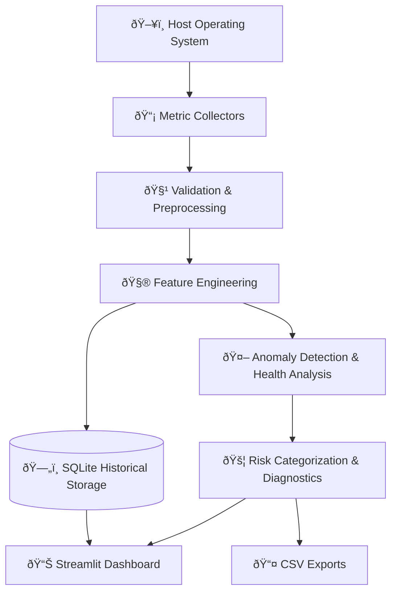

<div align="center">

# 🛡️ SentinelAI
### Intelligent Infrastructure Monitoring • Predictive Health & Incident Intelligence

**Collect telemetry. Detect anomalies. Score system health. Explain incidents with local AI, all in one dashboard.**


[Features](#-features) • [Architecture](#-architecture) • [Demo Guide](docs/HACKATHON_DEMO_GUIDE.md) • [Deployment](docs/DEPLOYMENT_AND_TROUBLESHOOTING.md) • [Quick Start](#-quick-start) • [Dashboard](#-dashboard)

</div>


---

> [!IMPORTANT]
> **Scope note:** Anomaly detection and resource-based risk indicators describe *observed system behavior*. They do **not** establish a validated probability that a hardware or operating-system failure will occur. Reliable failure prediction requires representative, labeled failure-event data.

## 📖 Overview

**SentinelAI** is an AI-augmented server health monitoring platform that observes the operational telemetry of computing infrastructure, detects multi-metric behavioral anomalies, and presents explainable, evidence-grounded risk intelligence.

It pairs a low-overhead host telemetry collection pipeline with a 39-feature **Isolation Forest** machine learning model, a state-of-the-art **Google Gemma 4 (`gemma-4-26b-a4b-it`)** LLM via the Google Gemini API for incident diagnostics, an instant **deterministic fallback engine**, and strict **OS-aware safety guardrails** (autonomous command execution is permanently disabled).

It also ships with **deterministic simulation scenarios**, allowing operators and judges to observe incident diagnostics under CPU spikes, memory leaks, or disk saturation **without stressing real machine hardware**.

## 📸 Preview

<!-- Add your screenshots to docs/screenshots/ and update the paths below -->
<div align="center">

| System Overview | Health & Risk Analysis |
| :---: | :---: |
|  |  |

| Historical Telemetry | Simulation & Diagnostics |
| :---: | :---: |
|  |  |

</div>

## ✨ Features

| | Feature | Description |
| :-: | --- | --- |
| 📡 | **Telemetry collection** | CPU, memory, disk, network activity, and running processes via `psutil` |
| 🧹 | **Validation & cleaning** | Handles missing, invalid, and non-finite metric values |
| 🧮 | **Feature engineering** | 39-feature vectors: rolling stats, sample deltas, process usage, and time signals |
| 🗄️ | **Historical storage** | Metrics, feature vectors, and validation records persisted in SQLite WAL mode |
| 🤖 | **Anomaly detection** | Isolation Forest flags telemetry outliers against learned baselines |
| 💯 | **Health score (0–100)** | Deterministic score calculated from anomaly probability and resource stress |
| 🚦 | **Risk categories** | Normal · Low · Moderate · High · Critical |
| 🧠 | **AI Incident Diagnostics** | Google Gemma 4 (`gemma-4-26b-a4b-it`) incident summarization, root causes, and runbooks |
| 🛡️ | **Deterministic Fallback** | Instant (<60ms) rule-based diagnosis when Ollama is offline or times out |
| 🔒 | **AI Safety & Human Review** | OS-aware dangerous-command filtering; zero autonomous destructive execution |
| 📊 | **Interactive dashboard** | Live gauges, multi-metric time series, anomaly audits, and DB inspector |
| ⏱️ | **Live & background monitoring** | One-off snapshots or periodic background collection loops |
| 🧪 | **Safe simulation** | Synthetic CPU, memory, disk, network, combined-pressure, and baseline scenarios |
| 🚀 | **FastAPI REST API** | Async endpoints for telemetry, ML scoring, simulation, and AI diagnostics |
| 🩺 | **Operational status** | Real-time probes distinguishing API health from Ollama model reachability |
| 📤 | **CSV exports** | Download monitoring and diagnostic data for offline analysis |
| 💾 | **Model management** | Atomic serialization with feature-schema validation and heuristic fallback |
| ✅ | **Automated testing** | 344 passing tests (334 core backend/API/ML tests + 10 Playwright E2E tests) |

## 🏗️ Architecture

### Data flow



### Project structure

```text
SentinelAI/
├── app/
│   ├── core/                 # Configuration and logging
│   ├── models/               # Telemetry data models
│   ├── collectors/           # System metrics collection
│   ├── preprocessing/        # Data validation and feature engineering
│   ├── database/             # SQLite persistence
│   ├── ml/                   # ML, simulation, health scoring
│   ├── ai/                   # LLM client, safety layer, diagnostic service
│   ├── api/                  # FastAPI REST endpoints and routers
│   ├── dashboard/            # Streamlit dashboard
│   └── utils/                # Shared utilities
├── frontend/                 # React + TypeScript frontend
├── data/                     # Local telemetry database
├── models/                   # ML model artifacts
├── logs/                     # Application logs
├── scripts/                  # Reproducible PowerShell launch & shutdown scripts
├── docs/                     # Guides, architecture, and hackathon demo script
├── tests/                    # Unit, integration and E2E Playwright tests
├── .env.example              # Example configuration
├── requirements.txt          # Python dependencies
├── run.py                    # CLI telemetry entry point
├── run_api.py                # Standalone FastAPI launcher
└── README.md
```

## 🧰 Tech Stack

| Area | Technology |
| --- | --- |
| Language | Python 3.12+ |
| System metrics | `psutil` |
| Machine learning | `scikit-learn` |
| Data processing | `numpy`, `pandas` |
| Dashboard | `Streamlit` |
| Visualizations | `Plotly` |
| Database | SQLite |
| Model serialization | `joblib` |
| Configuration | `python-dotenv` |
| Testing | `pytest` |

## 🚀 Quick Start

**Requirements:** Python 3.12+ · Node.js and npm · Windows (current setup is Windows-focused) · Git (optional)

### 1. Clone the repository

```powershell
git clone https://github.com/andhony07/AI-Based-Server-Health-Monitoring.git
cd AI-Based-Server-Health-Monitoring
```

### 2. Set up the Python environment

```powershell
python -m venv .venv
.\.venv\Scripts\Activate.ps1
python -m pip install --upgrade pip
python -m pip install -r requirements.txt
```

### 3. Configure environment variables

```powershell
Copy-Item .env.example .env
```

Edit `.env` if your configuration requires changes. Do not commit secrets.

### 4. Launch SentinelAI (Recommended)

To start both the FastAPI backend and Streamlit dashboard with prerequisite checks and port verification:

```powershell
.\scripts\start_sentinelai.ps1
```

To run pre-flight environment checks without starting background processes:
```powershell
.\scripts\start_sentinelai.ps1 -CheckOnly
```

To safely shut down both services:
```powershell
.\scripts\stop_sentinelai.ps1
```

---

### Alternative: Manual Multi-Terminal Launch

If you prefer interactive console logs in separate windows:

**Terminal 1 (FastAPI REST Backend):**
```powershell
.\.venv\Scripts\Activate.ps1
python run_api.py
```
*API is available at **http://127.0.0.1:8000** (Swagger documentation: **http://127.0.0.1:8000/docs**).*

**Terminal 2 (Streamlit Dashboard):**
```powershell
.\.venv\Scripts\Activate.ps1
python -m streamlit run app/dashboard/dashboard_main.py
```
*Dashboard is available at **http://localhost:8501**.*

**Optional: Ollama Local LLM (for live AI diagnostics):**
```powershell
ollama serve
# Verify qwen2.5:3b is available:
ollama list
```
*(If Ollama is stopped or unavailable, SentinelAI automatically activates its deterministic fallback engine without crashing or degrading ML scoring).*

---

## 📖 Documentation & Guides

- **[Hackathon Demonstration Script](docs/HACKATHON_DEMO_GUIDE.md)**: 5–7 minute step-by-step judge walkthrough covering normal health monitoring, synthetic anomaly simulation, ML health updates, AI incident diagnosis, deterministic fallback, and human-in-the-loop safety.
- **[Deployment & Troubleshooting Guide](docs/DEPLOYMENT_AND_TROUBLESHOOTING.md)**: Detailed environment configuration, port resolution, Ollama troubleshooting, test execution, and safe shutdown reference.
- **[System Architecture](docs/architecture.md)**: Deep dive into the collectors, 39-feature pipeline, SQLite WAL persistence, Isolation Forest ML scoring, FastAPI REST layer, and AI Diagnostic Assistant.

## 🛠️ Command Reference

| Goal | Command |
| --- | --- |
| Launch all services (Automated) | `.\scripts\start_sentinelai.ps1` |
| Pre-flight check only | `.\scripts\start_sentinelai.ps1 -CheckOnly` |
| Safe shutdown | `.\scripts\stop_sentinelai.ps1` |
| Launch Streamlit dashboard | `python -m streamlit run app/dashboard/dashboard_main.py` |
| Launch FastAPI backend | `python run_api.py` |
| Continuous telemetry loop | `python run.py` |
| Capture one telemetry snapshot | `python run.py --single-shot` |
| Train anomaly detection model | `python run.py --train` |
| Run core test suite | `pytest` |
| Run Playwright E2E test suite | `python -m pytest tests/e2e/test_dashboard_playwright.py` |

## 📊 Dashboard

| View | What you get |
| --- | --- |
| 🏠 **System Overview** | Current status plus CPU, memory, disk, network, and process metrics |
| ❤️ **Health & Risk Analysis** | Health score, anomaly score, risk category, and score breakdown |
| ⏱️ **Real-Time Monitoring** | On-demand snapshots and background monitoring controls |
| 📈 **Historical Telemetry** | Stored metrics over selectable time ranges |
| 🚨 **Anomaly Audit Log** | Historical anomaly scores and risk categories |
| 🧪 **Simulation & Diagnostics** | Run synthetic scenarios and inspect evidence and recommendations |
| 🩺 **Operational Status** | Component status, worker state, and telemetry freshness |
| 📤 **CSV Export** | Download supported records for offline analysis |
| 🗄️ **Database Inspection** | Record counts, sample timestamps, database size, recent records |

> An idle worker or stale telemetry may simply mean monitoring has not recently collected a sample.

## 🧠 How the Analysis Works

<details>
<summary><b>📡 Collected metrics</b></summary>

- **CPU:** overall utilization and core information
- **Memory:** total, used, available, and utilization
- **Disk:** total, used, free, and utilization
- **Network:** bytes sent/received and throughput
- **Processes:** process count and resource usage of top processes

</details>

<details>
<summary><b>🧮 Feature engineering</b></summary>

The preprocessing pipeline builds a numerical feature vector from current utilization, changes between samples, rolling-window statistics, process usage, time indicators, and flags for missing metric domains. The exact schema is defined by the implementation and must stay consistent with the saved model artifacts.

</details>

<details>
<summary><b>🤖 Machine learning & risk analysis</b></summary>

An **Isolation Forest** identifies telemetry that differs from patterns in the training data. Its anomaly score is shown separately from the **health score** (a deterministic indicator based on configured penalties) and the **risk category** (configured thresholds over current conditions).

These outputs describe observed behavior. They are **not** calibrated probabilities of future failure.

</details>

## 🧪 Simulation & Diagnostics

Deterministic synthetic scenarios for demos and regression testing:

`CPU spike` · `Memory pressure` · `Disk saturation` · `Network saturation` · `Combined resource pressure` · `Normal baseline`

Simulation feeds synthetic telemetry into the analysis pipeline. It **does not** exhaust real host resources or inject OS faults. Diagnostic recommendations are troubleshooting guidance based on available evidence, not proof of a root cause.

## 💾 Data Storage

Telemetry is stored locally in SQLite (default: `data/system_metrics.db`). It holds metric snapshots, engineered feature vectors, and preprocessing validation records. Transactions keep related records consistent, and retention cleanup is supported. The database is local to the machine running the app.

<details>
<summary><b>Check how many samples you have collected</b></summary>

```powershell
python -c "import sqlite3; conn = sqlite3.connect('data/system_metrics.db'); print('Samples:', conn.execute('SELECT COUNT(*) FROM system_metrics').fetchone()[0]); conn.close()"
```

</details>

## ⚙️ Configuration

Settings live in `.env` (see `.env.example`): application metadata, logging, collection intervals, process limits, preprocessing, and database behavior.

## ✅ Testing

```powershell
pytest
```

The latest reported run: **237 passed**. Coverage spans configuration, collectors, preprocessing, database, machine learning, dashboard services, simulation, diagnostics, operational status, CSV export, and integration behavior. Tests verify software behavior; they do not demonstrate predictive accuracy on real hardware failures.

## ⚠️ Scope & Limitations

- Isolation Forest flags deviations from the training baseline; it does not predict failures.
- The health score and risk categories reflect *current observed conditions*.
- Without a trained model or enough history, a heuristic fallback may be used where implemented.
- Simulated scenarios are for demonstration and testing, not authentic hardware-failure events.
- No validated probability or time-to-failure is estimated, since no labeled real-world failure data is used.

A supervised failure-prediction model would need suitable labeled data, a defined prediction horizon, and evaluation on held-out data that avoids temporal leakage.

## 👤 Author

**Andhony Saviyar S** · [@andhony07](https://github.com/andhony07)

---

<div align="center">

⭐ If you find this project useful, consider giving it a star!

</div>
