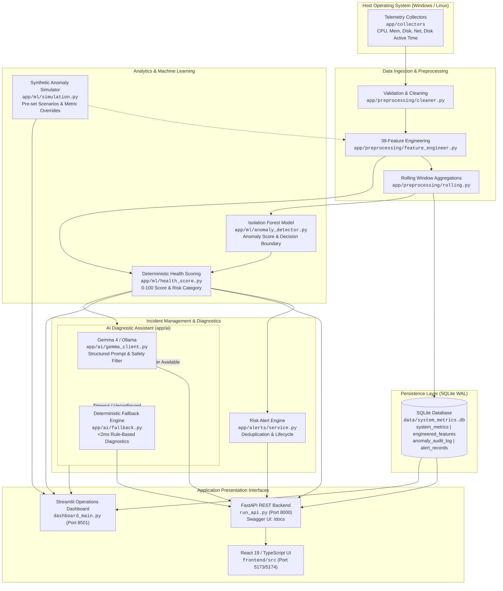
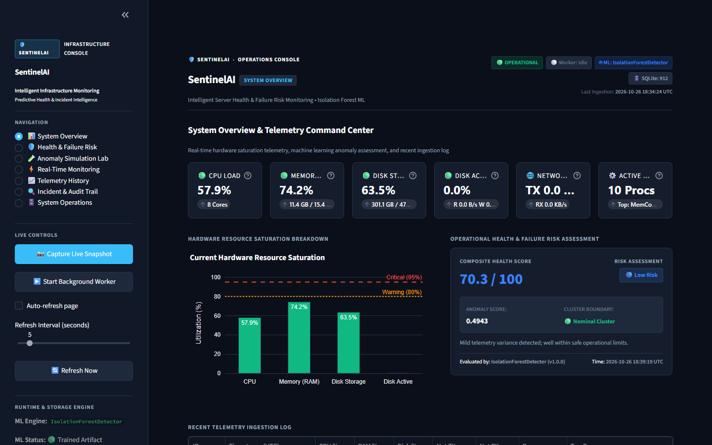
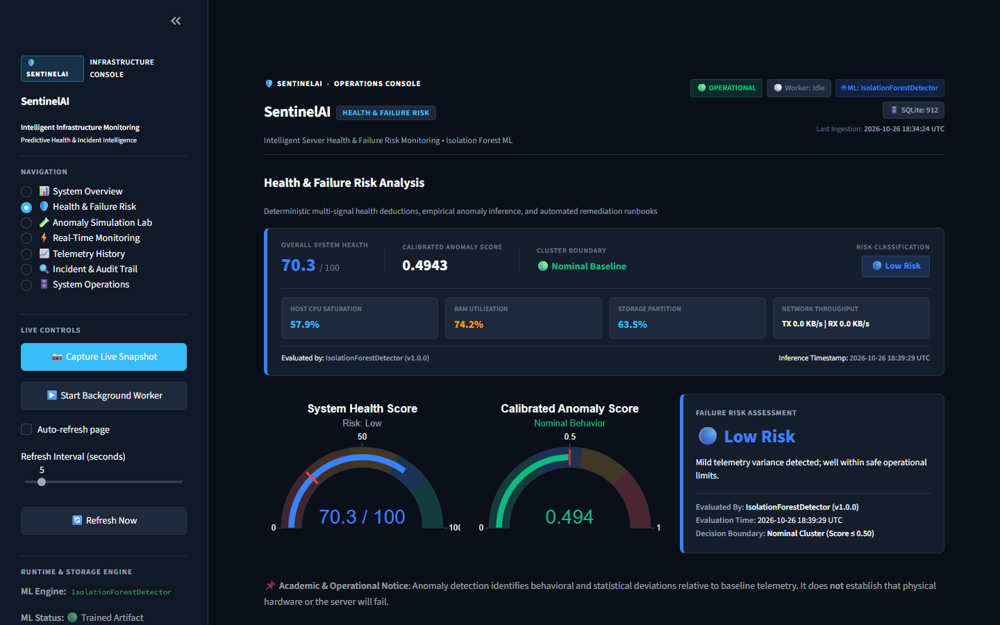
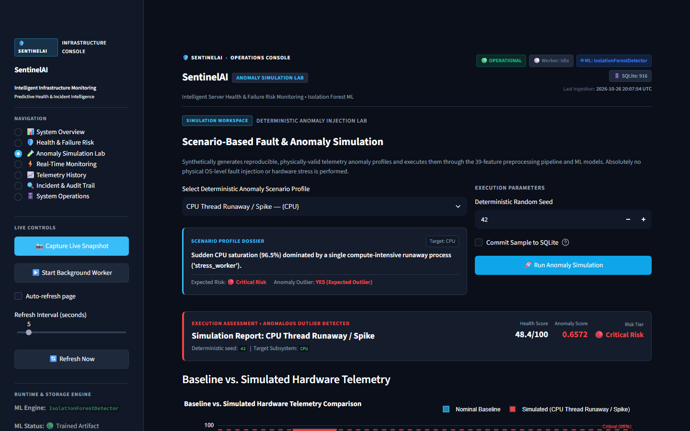
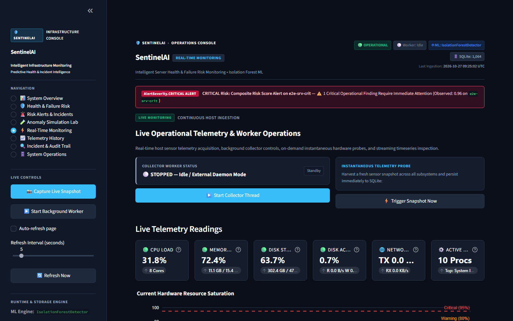
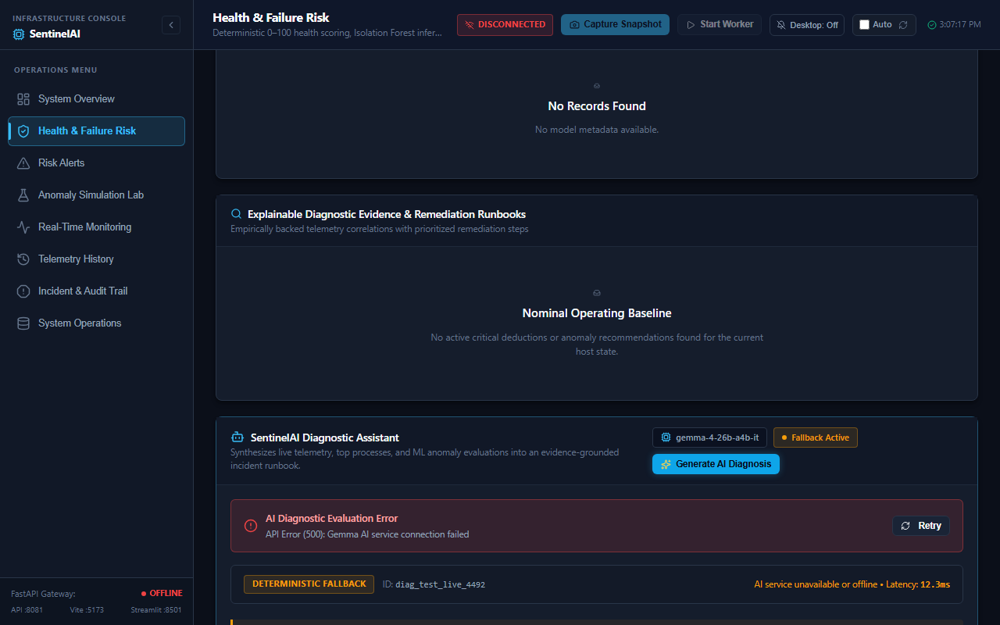
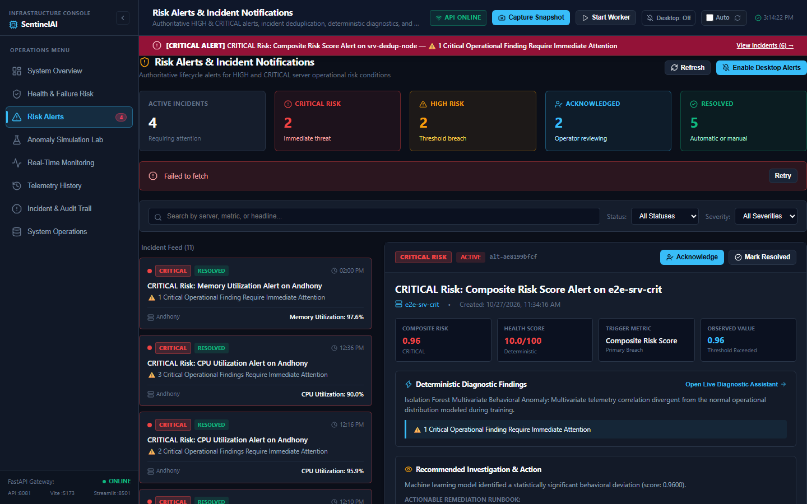

<div align="center">

# SentinelAI
### AI-Powered Server Health Monitoring and Predictive Failure Risk Analysis

**Continuous telemetry collection, unsupervised anomaly detection, deterministic health scoring, and AI incident diagnosis with instant fallback.**

[](https://www.python.org/)
[](https://fastapi.tiangolo.com/)
[](https://streamlit.io/)
[](https://react.dev/)
[](https://ai.google.dev/)
[](https://scikit-learn.org/)
[](https://sqlite.org/)

[](#limitations-and-safety)
[](#testing)
[](#testing)
[](#)

[Overview](#overview) | [Key Features](#key-features) | [Architecture](#architecture) | [Tech Stack](#technology-stack) | [Screenshots](#screenshots) | [Quick Start](#installation-and-setup) | [API Reference](#api-documentation) | [Testing](#testing)

</div>

---

> [!IMPORTANT]
> **Operational Scope Note:** Anomaly detection and resource-based risk indicators describe *observed system behavior*. They establish whether telemetry diverges from learned healthy baselines, but do **not** constitute an absolute guarantee of hardware failure timing. Autonomous execution of remediation actions is permanently disabled; all AI recommendations require mandatory human operator review.

---

## Overview

### The Problem
Modern server environments and cloud instances frequently experience silent memory leaks, gradual disk saturation, cascading process storms, and subtle I/O bottlenecks. Traditional monitoring tools rely heavily on static thresholds that trigger either too late or generate alert fatigue with noisy false positives. When an incident strikes, on-call operators are left manually parsing raw metric dashboards and logs to deduce root causes under pressure.

### The Solution: SentinelAI
**SentinelAI** bridges the gap between raw hardware telemetry and actionable incident resolution. It continuously collects high-frequency system metrics, ingests them through a 39-feature engineering pipeline, evaluates operational state using an unsupervised **Isolation Forest** model alongside a deterministic 0-100 health scoring engine, and synthesizes root-cause hypotheses using state-of-the-art LLMs (**Google Gemma 4** via Gemini API, with local **Ollama** support).

If cloud or local AI services become unreachable, SentinelAI's **deterministic fallback engine** engages in `< 2ms`, ensuring operators always receive structured diagnostic guidance with zero downtime and zero hallucination risk.

### Intended Users
* **DevOps & Site Reliability Engineers (SREs):** Seeking unified telemetry, proactive anomaly warnings, and triage checklists.
* **Systems Administrators & Platform Engineers:** Needing automated health scoring across CPU, memory, storage, and network interfaces.
* **Hackathon Evaluators & Technical Recruiters:** Evaluating end-to-end full-stack architectures combining machine learning, modern web interfaces, and LLM safety practices.

### Value Proposition
* **Zero Guesswork:** Replaces cryptic threshold alarms with transparent 0-100 health scores, anomaly margins, and prioritized remediation actions.
* **Dual-Interface Flexibility:** Run an interactive Python-native **Streamlit Operations Console** or a modern, responsive **React 19 / TypeScript Command Center**.
* **Enterprise-Grade Safety:** Complete resilience via instant deterministic fallback, non-destructive synthetic anomaly simulation, and strict human-in-the-loop controls.

---

## Key Features

- **Live Host Telemetry Collection:** Captures low-overhead hardware metrics per sample interval via `psutil` and Windows Performance Counters (`perfmon`/`Get-Counter`):
  - CPU: Overall utilization %, per-core breakdown, and process load.
  - Memory: Total, used, available, and percentage utilization.
  - Disk: Capacity, used, free space, and accurate Windows disk active-time % with rate-based fallback.
  - Network: Bytes sent/received, packet counts, and transmission rates (KB/s).
  - Processes: Total thread counts and top resource-consuming processes.
- **Unsupervised ML Anomaly Detection:** Employs an Isolation Forest algorithm trained on multi-metric baselines. It analyzes high-dimensional interactions across a 39-feature engineered vector (rate of change, rolling standard deviations, min/max spreads) without requiring pre-labeled failure sets.
- **Deterministic Health Scoring & Risk Classification:** Computes an explainable 0–100 health score applying calibrated penalty functions across resource domains. Automatically maps conditions into operational risk categories:
  - `HEALTHY` (Score 80–100): Normal operation within baseline envelopes.
  - `WARNING` (Score 50–79): Elevated utilization, persistent metric drift, or anomalous deviation.
  - `CRITICAL` (Score 0–49): Severe saturation, starvation risks, or critical anomaly thresholds.
- **AI-Powered Incident Diagnosis:** Integrates **Google Gemma 4 (`gemma-4-26b-a4b-it`)** via the Google Gemini API (and local Ollama models such as `qwen2.5:3b`) to produce structured incident analyses:
  - Root-cause hypotheses with confidence ratings.
  - Immediate mitigation commands (e.g., specific service restart or cache flushing syntax).
  - Follow-up investigation checklists with target metrics.
  - Model uncertainty boundaries and telemetry caveats.
- **Instant Deterministic Fallback Engine:** When AI endpoints time out (>30s) or are offline, SentinelAI executes rule-based diagnostic algorithms in `< 2ms`. Output is clearly badged as `DETERMINISTIC FALLBACK` with the failure reason to ensure operators never confuse fallback guidance with live model output.
- **Risk Alert & Notification Lifecycle:** Automatically dispatches alerts when servers cross into `HIGH` or `CRITICAL` risk. Features browser desktop notifications, alert deduplication across reconnections, full status lifecycles (`ACTIVE`, `ACKNOWLEDGED`, `RESOLVED`), and historical auditing.
- **Safe Synthetic Anomaly Simulation Lab:** Allows operators and evaluators to trigger deterministic failure patterns without stressing host hardware:
  - Scenarios: `CPU Spike`, `Memory Pressure`, `Disk Saturation`, `Network Saturation`, `Combined Resource Pressure`, and `Normal Baseline`.
  - **Custom Metric Overrides:** Allows injecting arbitrary user-defined values (CPU %, Memory %, Disk %, Network TX) to test edge-case diagnostic behavior safely.
- **Historical Telemetry, Audit Logs & CSV Export:** Searchable time-series tables, evaluated anomaly audit logs, and one-click CSV export endpoints (`/api/export/metrics.csv`, `/api/export/anomalies.csv`, `/api/export/features.csv`).
- **Operational Status & Persistence:** Built on SQLite with Write-Ahead Logging (WAL) for safe multi-threaded concurrency. Dedicated operational status checks report component readiness and telemetry freshness.
- **Human-in-the-Loop Safety:** Autonomous command execution is permanently disabled in application code. All diagnostic remediation steps are presented for mandatory human operator review.

---

## Architecture

SentinelAI follows a decoupled, data-driven architecture separating telemetry ingestion, machine learning analysis, incident management, and presentation.

### Data Flow



---

## Technology Stack

The platform is constructed entirely from battle-tested open-source libraries and verified production dependencies:

| Category | Technologies & Libraries | Purpose in SentinelAI |
| :--- | :--- | :--- |
| **Backend & REST API** | Python 3.12+, FastAPI, Uvicorn (ASGI), Pydantic v2 | High-concurrency asynchronous API routing, CORS handling, schema validation, and lifespan management. |
| **Machine Learning** | scikit-learn (`IsolationForest`), NumPy, Pandas | 39-feature engineering, baseline training, rolling-window variance calculation, and unsupervised anomaly scoring. |
| **Telemetry Collection** | `psutil`, Windows Performance Counters (`perfmon` / `Get-Counter`) | Host-native CPU, memory, storage, network, and precise Windows physical disk active time collection. |
| **Database & Storage** | SQLite 3 with Write-Ahead Logging (WAL) | Local ACID-compliant storage for metric snapshots, engineered features, audit logs, and alert records. |
| **AI Diagnostics** | Google Gemma 4 (`gemma-4-26b-a4b-it`) via Gemini API (`google-genai`), Ollama (`qwen2.5:3b`), Heuristic Fallback Engine | Multi-model incident diagnosis with strict OS-aware prompt formatting and instant (<2ms) offline fallback. |
| **Operations Dashboard** | Streamlit, Plotly Express & Graph Objects | Multi-page Python dashboard with interactive visualizers, simulation lab, and telemetry inspect tables. |
| **Web Frontend** | React 19, TypeScript, Vite, Recharts, Lucide React, Pure Vanilla CSS | Modern dark-mode command center, live metric charts, real-time alert center, and accessible diagnostic cards. |
| **Testing & Quality** | pytest, pytest-asyncio, HTTPX, Playwright (Chromium E2E) | 393 passing unit/integration tests and 12 automated browser end-to-end tests across both dashboards. |

---

## Screenshots

The following gallery showcases verified application views captured directly from the automated testing and verification runs:

<div align="center">

| System Overview & Live Telemetry | Health Scoring & Anomaly Analysis |
| :---: | :---: |
|  |  |
| *Real-time CPU, memory, disk active time, and network metrics.* | *Deterministic 0–100 health scoring and Isolation Forest decision boundaries.* |

| Anomaly Simulation Lab | Disk Telemetry & Activity Monitoring |
| :---: | :---: |
|  |  |
| *Non-destructive synthetic fault injection with custom metric overrides.* | *Live hardware activity monitoring, sample rates, and process inspect.* |

| AI Diagnostic Assistant (React Command Center) | Risk Alert Console & Incident Lifecycle |
| :---: | :---: |
|  |  |
| *Structured incident summary, root-cause confidence, and mitigation checklist.* | *Severity classification, in-browser alerts, acknowledgement, and resolution.* |

</div>

---

## Installation and Setup

### Prerequisites
* **Operating System:** Windows 10/11 (fully supported with native disk active-time collection) or Linux/macOS.
* **Python:** 3.12 or higher.
* **Node.js:** v18.0.0 or higher (for the React frontend).
* **PowerShell:** 5.1+ or PowerShell Core (on Windows).

### 1. Clone the Repository
```powershell
git clone https://github.com/andhony07/DevWatch-Monitoring.git
cd DevWatch-Monitoring
```

### 2. Set Up Python Virtual Environment
```powershell
python -m venv .venv
.\.venv\Scripts\Activate.ps1
python -m pip install --upgrade pip
pip install -r requirements.txt
```

### 3. Set Up React Frontend Dependencies
```powershell
cd frontend
npm install
cd ..
```

### 4. Configure Environment Variables
Copy the example configuration file and adjust settings as required:
```powershell
Copy-Item .env.example .env
```

Open `.env` in your editor. Configure your Google Gemini API key to enable Gemma 4 diagnostics:
```env
# AI Diagnostic Provider Configuration
AI_PROVIDER=gemma
GEMMA_API_KEY=your_gemini_api_key_here
GEMMA_MODEL=gemma-4-26b-a4b-it
AI_TIMEOUT_SECONDS=30.0

# Server & Network Ports
API_HOST=127.0.0.1
API_PORT=8000
```
*(If `GEMMA_API_KEY` is omitted or network access is unavailable, SentinelAI automatically engages its deterministic fallback engine without crashing or degrading ML scoring).*

### 5. (Optional) Local Ollama Setup
To run fully offline diagnostics without cloud API calls:
1. Install [Ollama](https://ollama.com/).
2. Pull the default open-weight model:
   ```powershell
   ollama pull qwen2.5:3b
   ```
3. Update `.env`:
   ```env
   AI_PROVIDER=ollama
   OLLAMA_MODEL=qwen2.5:3b
   OLLAMA_BASE_URL=http://localhost:11434
   ```

---

## Running the Application

### Option A: Automated Launch (Recommended)
SentinelAI provides verified PowerShell orchestration scripts that perform port validation, verify prerequisites, and launch background processes:

```powershell
# Run environment pre-flight checks without starting processes
.\scripts\start_sentinelai.ps1 -CheckOnly

# Start FastAPI REST backend and Streamlit dashboard
.\scripts\start_sentinelai.ps1

# Safely shut down all background SentinelAI services
.\scripts\stop_sentinelai.ps1
```

---

### Option B: Manual Multi-Terminal Launch

To inspect live logs across separate terminal windows:

#### Terminal 1 — FastAPI REST Backend
```powershell
.\.venv\Scripts\Activate.ps1
python run_api.py
```
* Backend runs at: `http://127.0.0.1:8000`
* Interactive OpenAPI Documentation: `http://127.0.0.1:8000/docs`

#### Terminal 2 — Streamlit Operations Dashboard
```powershell
.\.venv\Scripts\Activate.ps1
python -m streamlit run app/dashboard/dashboard_main.py
```
* Dashboard runs at: `http://localhost:8501`

#### Terminal 3 — React Command Center (Optional)
```powershell
cd frontend
npm run dev
```
* Web interface runs at: `http://localhost:5173` (or `http://localhost:5174`)

#### Production Frontend Build Verification
To validate the React bundle for production:
```powershell
npm --prefix frontend run build
```

---

## API Documentation

SentinelAI provides a comprehensive REST API. Interactive Swagger UI is available at `http://127.0.0.1:8000/docs` whenever the backend is running.

### System & Telemetry Endpoints
| Method | Path | Summary & Description |
| :--- | :--- | :--- |
| `GET` | `/healthz` | Basic API liveness probe. |
| `GET` | `/` | API root discovery with version and documentation paths. |
| `GET` | `/api/system/status` | Overall platform operational status, worker states, and telemetry freshness. |
| `GET` | `/api/telemetry/latest` | Most recent hardware telemetry snapshot (CPU, memory, disk, network, disk active time). |
| `POST` | `/api/telemetry/snapshot` | Triggers immediate on-demand hardware telemetry collection. |
| `GET` | `/api/telemetry/history` | Historical telemetry records with optional `limit` (default: 100). |

### Machine Learning & Risk Endpoints
| Method | Path | Summary & Description |
| :--- | :--- | :--- |
| `GET` | `/api/ml/prediction/latest` | Latest ML evaluation: anomaly score, health score (0-100), and risk category. |
| `GET` | `/api/ml/model/status` | Metadata on active Isolation Forest model, trained features, and version. |
| `GET` | `/api/ml/diagnostics/latest` | Deterministic diagnostic report attributing penalties across metric domains. |
| `GET` | `/api/anomalies/history` | Evaluated anomaly audit log with anomaly scores and decision scores. |
| `GET` | `/api/features/history` | Historical 39-feature engineered vectors. |

### AI Diagnostic Assistant Endpoints
| Method | Path | Summary & Description |
| :--- | :--- | :--- |
| `GET` | `/api/ai/latest` | Returns latest incident diagnosis (cached or instant deterministic fallback). |
| `POST` | `/api/ai/diagnose` | Triggers live on-demand incident diagnosis across recent telemetry. |
| `GET` | `/api/ai/status` | AI Diagnostic Assistant health: active provider, configured model, and availability. |

### Risk Alert & Lifecycle Endpoints
| Method | Path | Summary & Description |
| :--- | :--- | :--- |
| `GET` | `/api/alerts` | Filterable list of alert records (`severity`, `status`, `server_id`, `limit`). |
| `GET` | `/api/alerts/summary` | Aggregated metrics: active incidents, critical count, high count, acknowledged, resolved. |
| `GET` | `/api/alerts/{alert_id}` | Retrieve individual alert record with complete diagnostic payload. |
| `POST` | `/api/alerts/{alert_id}/acknowledge` | Mark an active alert as acknowledged by an operator. |
| `POST` | `/api/alerts/{alert_id}/resolve` | Mark an alert as resolved. |

### Simulation & Export Endpoints
| Method | Path | Summary & Description |
| :--- | :--- | :--- |
| `GET` | `/api/simulation/scenarios` | List available deterministic simulation scenarios. |
| `POST` | `/api/simulation/run` | Execute simulation with scenario name and optional custom metric overrides. |
| `GET` | `/api/export/metrics.csv` | Export raw telemetry metrics table as a downloadable CSV. |
| `GET` | `/api/export/anomalies.csv` | Export evaluated anomaly audit log as a CSV. |
| `GET` | `/api/export/features.csv` | Export engineered 39-feature dataset as a CSV. |

---

## Testing

SentinelAI maintains rigorous test coverage spanning unit, integration, mathematical validation, and end-to-end browser automation:

```powershell
# 1. Run complete Python regression suite (393 tests)
python -m pytest tests -q --ignore=tests/e2e

# 2. Run Playwright E2E browser automation suite (12 tests)
python -m pytest tests/e2e/test_dashboard_playwright.py -v

# 3. Run Windows disk activity telemetry unit tests (21 tests)
python -m pytest tests/test_disk_activity.py -v

# 4. Run Risk Alert system unit & integration tests (14 tests)
python -m pytest tests/test_alert_system.py -v

# 5. Validate React production build
npm --prefix frontend run build
```

### Verified Test Results Summary
* **Unit & Integration Suite (`pytest`):** **393 passed**, 0 failed, 3 warnings in 122s.
* **Playwright E2E Suite (`test_dashboard_playwright.py`):** **12 passed**, 0 failed in 65s (verifies application startup, dark command-center theme, system overview, health analysis, anomaly simulation, realtime telemetry, audit logs, database explorer, and React AI diagnostic assistant card).
* **Frontend TypeScript Build:** **Passed** in 999ms (`tsc -b && vite build` exited with code 0).
* **Git Cleanliness Check (`git diff --check`):** **Passed** with 0 errors.

---

## Limitations and Safety

### 1. Windows Disk Active-Time Telemetry
On Windows systems, SentinelAI collects true physical disk active time percentage using Windows Performance Counters (`\PhysicalDisk(_Total)\% Disk Time`) via background PowerShell/perfmon probes, closely mirroring Windows Task Manager. On non-Windows platforms (Linux/macOS), the collector gracefully falls back to rate-based psutil I/O calculation without interrupting telemetry.

### 2. AI Provider Availability and Fallback
Remote cloud APIs (such as Google Gemini) may encounter network latency, rate limits, or transient timeouts. SentinelAI enforces a strict 30-second timeout threshold. If an inference request fails or times out, the platform instantly engages its rule-based heuristic fallback engine in `< 2ms`, logging `DETERMINISTIC FALLBACK` and the root cause to ensure reliable operations.

### 3. Synthetic Anomaly Simulation vs. Real Faults
The Anomaly Simulation Lab injects purely mathematical synthetic feature vectors into the processing pipeline. It **does not** exhaust real machine RAM, pin physical CPU cores to 100%, or corrupt file system disks.

### 4. Mandatory Human Operator Review
AI-generated remediation steps (such as `kill -9 <pid>`, database vacuuming, or restarting background daemons) are strictly advisory. SentinelAI deliberately omits automated execution capabilities to eliminate the possibility of unintended system outages or destructive command loops.

---

## Project Structure

```text
SentinelAI/
├── app/
│   ├── ai/                   # Google Gemma 4 & Ollama clients, fallback, safety filters
│   ├── alerts/               # Risk alert engine, deduplication, status lifecycle
│   ├── api/                  # FastAPI REST backend, route handlers, dependencies
│   ├── collectors/           # Hardware telemetry collectors (CPU, Mem, Disk, Net)
│   ├── core/                 # Application configuration, settings, and logging
│   ├── dashboard/            # Streamlit operations dashboard, charts, theme tokens
│   ├── database/             # SQLite connection, schema, migrations, WAL repository
│   ├── ml/                   # Isolation Forest detector, health scoring, simulation
│   ├── models/               # Telemetry and feature schemas
│   ├── preprocessing/        # Validation, cleaning, 39-feature engineering, rolling stats
│   └── utils/                # Formatting, timing, and string utilities
├── frontend/                 # React 19 + TypeScript Command Center
│   ├── src/
│   │   ├── api/              # Typed REST client functions
│   │   ├── components/       # Layout, TopBar, Sidebar, AIDiagnosticCard
│   │   ├── styles/           # Pure Vanilla CSS design system and tokens
│   │   ├── types/            # TypeScript interfaces for telemetry, alerts, and AI
│   │   └── views/            # Health, Overview, Alerts, and Diagnostics views
│   ├── package.json          # Frontend dependencies (React 19, Lucide, Recharts)
│   └── vite.config.ts        # Vite configuration and proxy rules
├── data/                     # Local SQLite database (system_metrics.db)
├── models/                   # Saved Isolation Forest model artifacts (.joblib)
├── docs/                     # Demonstration scripts and architecture guides
├── scripts/                  # Automated PowerShell startup and shutdown scripts
├── tests/                    # 45 test files covering all modules and services
│   ├── e2e/                  # Playwright browser end-to-end test suites
│   └── screenshots/          # Verified test run screenshot captures
├── requirements.txt          # Python dependencies
├── run.py                    # Standalone continuous telemetry collection loop
├── run_api.py                # Dedicated FastAPI REST server launcher
├── .env.example              # Sample environment configuration template
└── README.md                 # Complete project documentation
```

---

## Documentation & Guides

* **[Hackathon Demonstration Script](docs/HACKATHON_DEMO_GUIDE.md):** 5–7 minute step-by-step judge walkthrough covering normal health monitoring, synthetic anomaly simulation, ML health updates, AI incident diagnosis, deterministic fallback, and human-in-the-loop safety.
* **[Deployment & Troubleshooting Guide](docs/DEPLOYMENT_AND_TROUBLESHOOTING.md):** Detailed environment configuration, port resolution, AI provider troubleshooting, test execution, and safe shutdown reference.
* **[System Architecture](docs/architecture.md):** Deep dive into the collectors, 39-feature pipeline, SQLite WAL persistence, Isolation Forest ML scoring, FastAPI REST layer, and AI Diagnostic Assistant.

---

## Roadmap

- [ ] **Multi-Node Agent Aggregation:** Lightweight collector agents reporting telemetry from multiple remote nodes to a centralized SentinelAI coordinator.
- [ ] **eBPF Linux Telemetry:** Kernel-level socket and disk latency profiling on Linux hosts using eBPF probes.
- [ ] **Webhook Alert Integrations:** Outbound webhook dispatch to Slack, PagerDuty, and Discord incident channels.
- [ ] **Custom Fine-Tuned Gemma Weights:** Specialized fine-tuning on Linux sysadmin troubleshooting manuals and post-mortem post-incident reports.

---

## Contributing

Contributions, bug reports, and feature proposals are welcome!

1. Fork the repository.
2. Create a feature branch (`git checkout -b feature/improved-collector`).
3. Ensure all Python tests pass (`python -m pytest tests -q --ignore=tests/e2e`).
4. Ensure the frontend builds without errors (`npm --prefix frontend run build`).
5. Ensure code style compliance (`git diff --check`).
6. Open a descriptive Pull Request.

---

## License

This project is licensed under the MIT License — feel free to use, modify, and distribute this software for educational, research, or commercial purposes.

---

<div align="center">

**SentinelAI** · Built with Python, FastAPI, Streamlit, React 19, and Google Gemma · Maintained by [@andhony07](https://github.com/andhony07)

</div>
